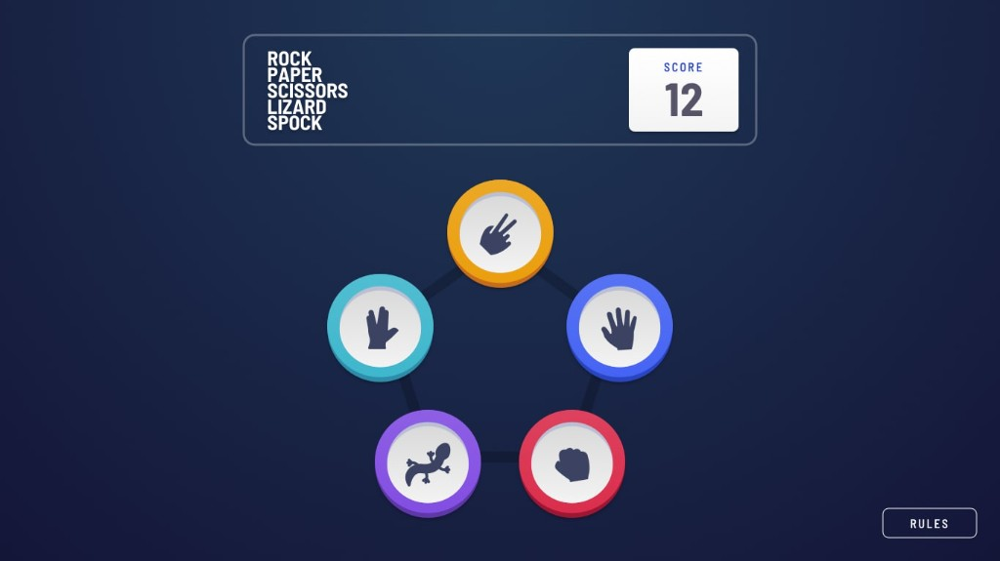
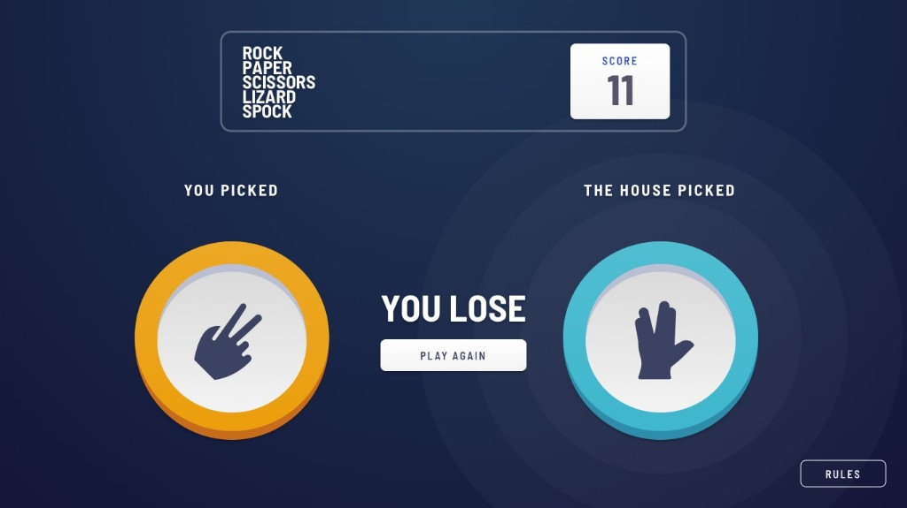

# Frontend Mentor - Rock, Paper, Scissors solution

This is a solution to the [Rock, Paper, Scissors challenge on Frontend Mentor](https://www.frontendmentor.io/challenges/rock-paper-scissors-game-pTgwgvgH). Frontend Mentor challenges help you improve your coding skills by building realistic projects.

## Table of contents

- [Overview](#overview)
  - [The challenge](#the-challenge)
  - [Screenshot](#screenshot)
  - [Links](#links)
- [My process](#my-process)
  - [Built with](#built-with)
  - [What I learned](#what-i-learned)
  - [Continued development](#continued-development)
  - [Useful resources](#useful-resources)
- [Getting started](#getting-started)
- [Author](#author)
- [Acknowledgments](#acknowledgments)

## Overview

### The challenge

Users should be able to:

- View the optimal layout for the game depending on their device's screen size
- Play **Rock, Paper, Scissors, Lizard, Spock** against the house
- Follow the full match flow: pick → waiting → house reveal → result
- See a winner glow on the winning hand and update the score
- Keep the score after refreshing the browser (`localStorage`)
- Open and close a rules modal

### Screenshot





### Links

- Solution URL: [https://github.com/sergiofisio/challenge-rock-paper-scissors-master](https://github.com/sergiofisio/challenge-rock-paper-scissors-master)
- Live Site URL: [https://sergiofisio.github.io/challenge-rock-paper-scissors-master/](https://sergiofisio.github.io/challenge-rock-paper-scissors-master/)

## My process

### Built with

- Semantic HTML5 markup
- CSS custom properties / design tokens
- Flexbox and CSS Grid
- Mobile-first responsive layout
- [Next.js](https://nextjs.org/) (App Router) + TypeScript
- [Tailwind CSS](https://tailwindcss.com/) v4
- Vitest for unit tests on game rules and score storage
- Discriminated `GamePhase` + `useGame` hook for match flow
- Static export + GitHub Actions → GitHub Pages

### What I learned

- Recreating the 3D token look with layered shadows: color lip under the ring, inset shadow on the face, and soft ambient drop shadow
- Modeling Rock–Paper–Scissors–Lizard–Spock win rules as a small lookup map instead of a long chain of conditionals
- Keeping score persistence SSR-safe and resilient when `localStorage` throws (private browsing)
- Shipping a Next.js app to GitHub Pages with `output: "export"`, `basePath`, and a Pages workflow

One hard problem: on GitHub Pages every image 404’d because `next/image` does not prefix root-relative `src` with `basePath`. The fix was a tiny `asset()` helper that prepends `NEXT_PUBLIC_BASE_PATH`, used for icons, logo, pentagon, rules art, and the favicon. Without that, the live tokens looked like empty circles even though local `yarn dev` was fine.

### Continued development

- Closer pixel polish against mobile/tablet mocks
- Motion for pick → result transitions
- Optional classic (triangle) mode alongside the bonus pentagon

### Useful resources

- [Frontend Mentor challenge brief](https://www.frontendmentor.io/challenges/rock-paper-scissors-game-pTgwgvgH) — requirements and bonus rules
- [Next.js static exports](https://nextjs.org/docs/app/guides/static-exports) — GitHub Pages-friendly build
- [Big Bang Theory: Rock Paper Scissors Lizard Spock](https://bigbangtheory.fandom.com/wiki/Rock-Paper-Scissors-Lizard-Spock) — bonus hand relationships

## Getting started

```bash
yarn install
yarn dev
```

Open [http://localhost:3000](http://localhost:3000).

```bash
yarn test
yarn build   # static export to /out (set GITHUB_PAGES=true for Pages basePath)
yarn lint
```

## Author

- GitHub - [@sergiofisio](https://github.com/sergiofisio)

## Acknowledgments

- Design and assets from [Frontend Mentor](https://www.frontendmentor.io)
